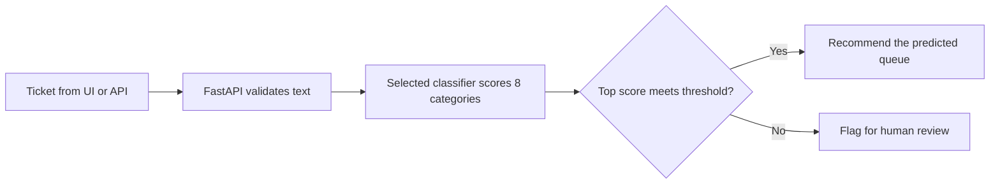

# QueuePilot

**Confidence-based routing for IT support tickets.** QueuePilot reads a ticket, ranks the three most likely support categories out of eight, and recommends either automatic routing or human review. Support agents can inspect the decision in a browser or request it through a REST API.

**Stack** · Python · scikit-learn · PyTorch · FastAPI · DVC · Docker

A ticket like “Cannot access my account” illustrates the triage problem. The baseline predicts **Access**, but its confidence is **0.533**, below its **0.57** routing threshold. QueuePilot returns the category suggestion and flags the ticket for review. For “My laptop keyboard is broken,” the same model predicts **Hardware** with **0.976** confidence and recommends automatic routing. Both examples are outputs from the fitted baseline.

## How a ticket becomes a routing decision



- **Confidence drives the decision.** The default model uses TF-IDF features and logistic regression with sigmoid calibration. Calibration makes the scores more meaningful when deciding how much confidence to place in a prediction.
- **The threshold comes from tuning data.** For each model, the selection rule seeks the greatest coverage whose lower confidence bound on auto-routed accuracy reaches 90%. Both models qualified. The baseline accepted **83.83%** of tuning tickets versus **83.91%** for TextCNN. CNN promotion requires a coverage improvement of at least **2 percentage points**, so the baseline remains the default. [Model selection record](reports/metrics/model_selection.json)
- **Each threshold belongs to a specific model.** At startup, the service checks the model’s SHA-256 against its threshold record. Loading fails on a mismatch. The CNN also checks its vocabulary, label mapping and configuration before serving. [Inference code](src/inference.py)

## Evaluation

The reports regenerated on 11 November 2026 evaluate the two locally retrained models on **4,787 held-out tickets**. Coverage is the share of all tickets accepted for automatic routing. The last column measures accuracy on that accepted subset.

| Backend | Routing threshold | Overall accuracy | Coverage | Accuracy on accepted tickets |
| --- | ---: | ---: | ---: | ---: |
| TF-IDF + logistic regression | 0.57 | 85.75% | 82.56% | 92.16% |
| TextCNN | 0.77 | 84.19% | 84.25% | 91.02% |

For the baseline, that split corresponds to **3,952 recommendations for automatic routing** and **835 referrals for review**. [Baseline report](reports/metrics/baseline_routing_metrics.json) · [TextCNN report](reports/metrics/routing_metrics.json) · [Dataset](https://www.kaggle.com/datasets/adisongoh/it-service-ticket-classification-dataset)

**Verification and release status.** The maintained [release status](docs/RELEASE_STATUS.md) identifies the published model pair, confirmed CI evidence and pending source changes. Older local test counts and reproduction notes are kept in the [dated archive](docs/history/2026-11-11-reproduction.md). The current metrics above belong to the preserved 11 November model pair; provenance fixes have not retrained those models.

The CNN uses the same tune partition for checkpoint and threshold selection. The threshold-grid correction does not cover that entire adaptive selection process, so the 90% rule is an empirical selection criterion for this run, not an end-to-end production guarantee. [Design options and costs](docs/EXPERIMENT_DESIGN.md)

## Try a ticket

With the service running locally, open `http://127.0.0.1:8000` for the browser UI or send a request from PowerShell:

```powershell
Invoke-RestMethod -Method Post -Uri http://127.0.0.1:8000/predict `
  -ContentType "application/json" `
  -Body '{"text":"Cannot access my account"}'
```

Read `category` for the suggested queue and `needs_manual_review` for the routing decision. The response also includes `confidence`, `threshold` and `top_3`. When API-key authentication is enabled, supply the key in the `X-API-Key` header.

<details>
<summary>Start the baseline on Windows</summary>

From the repository root, with Python 3.12 and DVC authenticated to the [QueuePilot model repository](https://dagshub.com/Arda-Yaz/QueuePilot), run:

```powershell
py -3.12 -m venv .venv
.\.venv\Scripts\python.exe -m pip install --require-hashes -r requirements/base.txt
dvc pull artifacts/baseline.joblib
.\.venv\Scripts\python.exe -m uvicorn app.main:app --host 127.0.0.1 --port 8000
```

</details>

[Deployment guide](docs/deploy.md) · [Code map](docs/PORT_MAP.md) · [License](LICENSE)


See [reproduction instructions](docs/REPRODUCTION.md) for inputs, source snapshots, prediction provenance and the historical LF lock migration.
