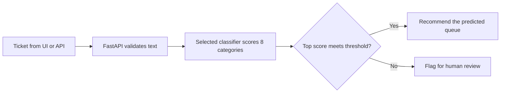

# QueuePilot

**Confidence-based routing for IT support tickets.** QueuePilot reads a ticket, ranks the three most likely support categories out of eight, and recommends either automatic routing or human review. Support agents can inspect the decision in a browser or request it through a REST API.

**Stack** · Python · scikit-learn · PyTorch · FastAPI · DVC · Docker

QueuePilot is a reproducible reference system evaluated on a public eight-label dataset. Organization adoption is intended to start with a human-reviewed pilot: validate category-to-queue meanings, collect corrections, then adapt the model and thresholds to that organization's data. Operator feedback storage, configurable organization queue mapping and automatic retraining are roadmap items. [Current scope and adaptation roadmap](docs/PROJECT_SCOPE.md)

A ticket like “Cannot access my account” illustrates the triage problem. The baseline predicts **Access**, but its confidence is **0.533**, below its **0.60** routing threshold. QueuePilot returns the category suggestion and flags the ticket for review. For “My laptop keyboard is broken,” the same model predicts **Hardware** with **0.976** confidence and recommends automatic routing. Both examples are outputs from the fitted baseline.

## How a ticket becomes a routing decision



- **Confidence drives the decision.** The default model uses TF-IDF features and logistic regression with sigmoid calibration. Calibration makes the scores more meaningful when deciding how much confidence to place in a prediction.
- **Backend and threshold use separate data.** Checkpoint Macro-F1 selects the backend before risk threshold tuning: baseline **0.8690**, CNN **0.8548**. The baseline is frozen first; its independent risk threshold is **0.60**. The old coverage-based promotion rule is superseded. [Selection protocol](docs/SELECTION_PROTOCOL.md) · [Model selection record](reports/metrics/model_selection.json)
- **Each threshold belongs to a specific model.** At startup, the service checks the model’s SHA-256 against its threshold record. Loading fails on a mismatch. The CNN also checks its vocabulary, label mapping and configuration before serving. [Inference code](src/inference.py)

## Evaluation

The reports regenerated on 11 November 2026 evaluate the two locally retrained models on **4,787 held-out tickets**. Coverage is the share of all tickets accepted for automatic routing. The last column measures accuracy on that accepted subset.

| Backend | Routing threshold | Overall accuracy | Coverage | Accuracy on accepted tickets |
| --- | ---: | ---: | ---: | ---: |
| TF-IDF + logistic regression | 0.60 | 85.75% | 79.09% | 92.95% |
| TextCNN | 0.84 | 84.06% | 75.37% | 92.38% |

For the baseline, that split corresponds to **3,786 recommendations for automatic routing** and **1,001 referrals for review**. [Baseline report](reports/metrics/baseline_routing_metrics.json) · [TextCNN report](reports/metrics/routing_metrics.json) · [Dataset](https://www.kaggle.com/datasets/adisongoh/it-service-ticket-classification-dataset)

**Verification and release status.** The maintained [release status](docs/RELEASE_STATUS.md) identifies the current local model pair and distinguishes historical hosted CI evidence from the new local run. Older local test counts and reproduction notes are kept in the [dated archive](docs/history/2026-11-11-reproduction.md). The metrics above belong to the new protocol v2 model pair, trained from committed source with recoverable provenance.

Protocol v2 uses disjoint checkpoint and risk partitions. These data have a history of prior analysis, so current held-out results remain descriptive measurements; they do not establish unconditional production guarantees. [Protocol and limits](docs/SELECTION_PROTOCOL.md)

## Try a ticket

With the service running locally, open `http://127.0.0.1:8000` for the browser UI or send a request from PowerShell:

```powershell
Invoke-RestMethod -Method Post -Uri http://127.0.0.1:8000/predict `
  -ContentType "application/json" `
  -Body '{"text":"Cannot access my account"}'
```

Read `category` for the suggested queue and `needs_manual_review` for the routing decision. The response also includes `confidence`, `threshold` and `top_3`. When API-key authentication is enabled, supply the key in the `X-API-Key` header.

<details>
<summary>Start the baseline on Windows</summary>

The `dvc pull` step requires the model objects referenced by the current lock to
be available in the remote and DVC credentials to be configured. Remote
availability was not rechecked in this documentation/analysis change. Locally
available artifacts can also be used, or [reproduce the pipeline](docs/REPRODUCTION.md).

From the repository root, with Python 3.12 and DVC authenticated to the [QueuePilot model repository](https://dagshub.com/Arda-Yaz/QueuePilot), run:

```powershell
py -3.12 -m venv .venv
.\.venv\Scripts\python.exe -m pip install --require-hashes -r requirements/base.txt
dvc pull artifacts/baseline.joblib
.\.venv\Scripts\python.exe -m uvicorn app.main:app --host 127.0.0.1 --port 8000
```

</details>

[Deployment guide](docs/deploy.md) · [Code map](docs/PORT_MAP.md) · [License](LICENSE)


See [reproduction instructions](docs/REPRODUCTION.md) for inputs, source snapshots, prediction provenance and the historical LF lock migration.

## Scope and further development

The 92.95% accepted accuracy above belongs to the recorded dataset benchmark. Queue descriptions and routing policies should be validated against an organization's actual workflows during adoption; new label meanings require suitable labeled data and evaluation.

Additional [development experiments](docs/DEVELOPMENT_ERROR_ANALYSIS_2026-11-12.md), [external/synthetic diagnostics](docs/EXTERNAL_DATA_AND_STRESS_2026-11-12.md) and a [taxonomy review pilot](docs/TAXONOMY_AND_ANNOTATION_2026-11-12.md) are preserved as research evidence. They have not replaced the release model or its benchmark results. Proposed category definitions are not presented as the original publisher's verified taxonomy. [Implemented capabilities versus roadmap](docs/PROJECT_SCOPE.md)
