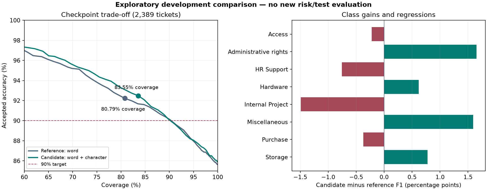

# QueuePilot geliştirme hata analizi — 12 Kasım 2026

Kapsam notu: bu belge ek geliştirme/kuruma uyarlama araştırmasıdır. Mevcut veri kümesinde tamamlanan benchmark sonucunu değiştirmez ve referans uygulamanın tamamlanması için yeni bir zorunluluk tanımlamaz. [Proje kapsamı ve yol haritası](PROJECT_SCOPE.md).

Bu çalışma mevcut üretim modelini değiştirmeden, train ve checkpoint üzerinde
hata teşhisi ve önceden sınırlandırılmış tek bir aday karşılaştırması yapar.
Risk, calibration ve test bölümlerinde yeni performans değerlendirmesi yapılmadı.
Bu belgede karşılaştırılan sayılar **aynı 2.389 checkpoint kaydına** aittir;
önceki test sonuçlarıyla birbirine karıştırılmamalıdır.

## Referans ve veri sınırı

- Başlangıç Git sürümü: `b615135`; çalışma dalı `codex/development-error-analysis`.
- Referans: protokol v2 baseline modeli; model SHA-256 değeri
  `ea6b1f9ca0075bd32ee39d01a249b4b8860537f576e52ba8e8afc6dd1a169843`.
- Train: 33.485; checkpoint: 2.389 kayıt. Kimlik listeleri ve ham veri hash'leri
  doğrulandı; train/checkpoint kesişimi ve yinelenen ID'ler reddediliyor.
- Ham veri, mevcut temizleyiciyle ID çözümlemesi için okunuyor. Analiz ve fit
  yalnız train/checkpoint satırlarına uygulanıyor; risk/test ID, tahmin veya
  performans raporları aday seçimine girdi olmuyor.
- Tam metinler, satır bazındaki tahminler ve inceleme tablosu yalnız Git'in yok
  saydığı `reports/private/development-analysis` dizininde tutuluyor. Paylaşılabilir
  raporlar toplulaştırılmış sayıları ve provenance hash'lerini içeriyor.

## Hata analizinin bulguları

Train doğruluğu 0,9241 ve Macro-F1 0,9363; checkpoint doğruluğu 0,8564 ve Macro-F1
0,8690. Train ölçümü modelin gördüğü veriden geldiği için genelleme kanıtı değildir.
Bu fark tek başına hata nedeninin overfitting olduğunu da kanıtlamaz.

Checkpoint'te 343 yanlış tahmin var; bunların 20'sinin güveni en az 0,80.
Hataların yaklaşık %93,88'inde gerçek sınıf ilk üç tahmin içinde. Bu, doğru
alternatifin çoğunlukla tamamen kaybolmadığını gösterir; ilk üç önerinin başarılı
olması otomatik yönlendirmenin doğru olduğu anlamına gelmez.

En yaygın hata çiftleri:

| Gerçek sınıf | Tahmin | Adet |
| --- | --- | ---: |
| HR Support | Hardware | 46 |
| Hardware | Miscellaneous | 37 |
| Hardware | HR Support | 33 |
| Miscellaneous | Hardware | 30 |
| HR Support | Miscellaneous | 25 |
| Access | Hardware | 15 |
| Administrative rights | Hardware | 15 |

Dolayısıyla yalnız Administrative rights'a odaklanmak toplam hatanın çoğunu
çözmeyecektir. Checkpoint'te bu sınıfın 88 örneği var; 17 yanlışın 15'i Hardware'a
gidiyor. Precision 0,8452, recall 0,8068 ve F1 0,8256.

Mevcut 0,60 eşiğinde iki farklı dilim farklı anlam taşır:

| Checkpoint dilimi | Kabul edilen | Doğru | Doğruluk |
| --- | ---: | ---: | ---: |
| Gerçek etiketi Administrative rights olanlar | 71 | 61 | %85,92 |
| Administrative rights olarak yönlendirilenler | 67 | 61 | %91,04 |
| Hardware olarak yönlendirilenler | 562 | 500 | %88,97 |

Gerçek sınıf üretimde bilinmez. İlk satır sınıfın kaçırılmasıyla, ikinci ve üçüncü
satırlar hedef kuyruğa yanlış bilet gönderilmesiyle ilgilidir. Genel doğruluk
hedefi her kuyruk için ayrı bir güvence sağlamaz. Hardware dilimi, toplam kabul
edilmiş hatalara katkısı nedeniyle ayrıca önemlidir.

### Örnek incelemesi ve doğrulanmamış nedenler

Yerel örnek incelemesinde Administrative rights etiketi altında kısa monitör,
batarya ve ses sorunu anlatımları görüldü. Aynı sınıfın doğru tahmin edilen
örneklerinde Outlook/profile ve Windows güncellemesi anlatımları bulunuyor.
Bu, sınıf adının gündelik anlamı ile veri taksonomisi arasında belirsizlik
olabileceğine işaret ediyor. Etiket rehberi veya alan uzmanı doğrulaması olmadan
bu örnekler yanlış etiketli ilan edilmedi ve hiçbir etiket değiştirilmedi.

Kontrol olarak, ilk kalibrasyon fold'unun kelime TF-IDF uzayında 88 Administrative
rights checkpoint kaydı için en yakın train kaydı incelendi. Farklı etiketli ve
cosine similarity >=0,85 olan en yakın komşu sayısı sıfırdı. Bu dar kontrol
neredeyse aynı metinlerin çelişkili etiketlendiğini doğrulamadı; taksonominin
doğruluğunu veya bütün veri kümesinin temiz olduğunu kanıtlamaz.

Train fold'larının kelime sözlükleri birleştirilerek yapılan kapsam kontrolünde,
checkpoint hatalarında ortalama bilinmeyen token oranı %0,35, doğrularda %0,40.
Genel hata için basit bir OOV açıklaması desteklenmedi. Administrative rights
hatalarında kısa token oranı daha yüksek (%23,35; doğrularda %16,88), fakat yalnız
17 hata üzerinden bu gözlem nedensel bir açıklama değildir.

## Tek değişiklikli karşılaştırma

Hipotez: kelime unigram/bigram özelliklerine karakter parçaları eklemek, kısa
teknik ifadeler ve sözcük biçimleri için tamamlayıcı temsil sağlayabilir.
Bu bir teşhis sonucu değil, sınanabilir geliştirme hipotezidir.

Değişen tek özellik dalı: `char_wb`, 3–5 karakter, `min_df=2`, en fazla 50.000
özellik, sublinear TF, ağırlık 1. Kelime dalının ayarları ve lojistik regresyonun
parametreleri aynen korundu. Kalibrasyon yine train içinde beş katlı sigmoid;
vektörleştiriciler her fold'un pipeline'ı içinde fit ediliyor. Checkpoint fit
işlemine girmiyor. Hiperparametre araması veya ikinci aday çalıştırılmadı.

Plan fit öncesi kaydedildi. Önceden belirlenen geliştirme taraması: Macro-F1
düşmesin; aynı hedef/güven sınırı formülüyle checkpoint coverage en az 1 yüzde
puan artsın; Administrative rights F1 kaybı 2 yüzde puanı aşmasın. Bu tarama
bir aday önceliklendirme kuralıdır; üretim kabul kriteri veya yeni garanti değildir.

### Checkpoint sonucu

| Ölçüm | Referans | Kelime + karakter |
| --- | ---: | ---: |
| Toplam doğruluk | %85,64 | %85,89 |
| Macro-F1 | 0,8690 | 0,8712 |
| Administrative rights F1 | 0,8256 | 0,8421 |
| Geliştirme seçim eşiği | 0,59 | 0,56 |
| Geliştirme coverage | %80,79 | %83,55 |
| Kabul edilenlerde doğruluk | %92,23 | %92,48 |
| Kabul edilen / doğru | 1.930 / 1.780 | 1.996 / 1.846 |
| Keşif amaçlı hesaplanan alt sınır | %90,05 | %90,37 |
| Güveni >=0,80 olan yanlışlar | 20 | 21 |

Coverage aynı 0,90 hedefi, alpha 0,05, 90 eşik adayı ve en az 50 kabul koşuluyla
hesaplandı. Bu kez eşik ve aday checkpoint'e bakılarak değerlendirildiğinden
tablodaki alt sınırlar **bağımsız risk doğrulaması değildir**. 0,56 adayın üretim
eşiği olarak kaydedilmedi; referansın üretim eşiği 0,60 olarak kaldı.

Artış yaklaşık 2,76 yüzde puanı, yani 66 ek kabul. Aynı kayıtlardaki eşleştirilmiş
karşılaştırmada aday 61 hatayı düzeltti, referansın doğru yaptığı 55 kaydı bozdu:
net yalnız 6 ek doğru var. Dolayısıyla genel sınıflandırmada büyük veya istatistiksel
olarak kanıtlanmış bir sıçrama iddia edilmiyor.

Sabit 0,60 eşiğinde farklı bir sonuç görülüyor: coverage %79,74'ten %77,94'e
düşüyor; kabul doğruluğu %92,49'dan %93,93'e çıkıyor. Aynı sayısal eşik,
kalibrasyonu değişen iki modelde aynı operasyonel noktayı temsil etmiyor.
Bu nedenle hem sabit eşik hem sabit seçim ölçütü sonuçları birlikte raporlandı.

| Sınıf | Checkpoint adet | Referans F1 | Aday F1 | Fark (yüzde puanı) |
| --- | ---: | ---: | ---: | ---: |
| Access | 356 | 0,8949 | 0,8927 | -0,22 |
| Administrative rights | 88 | 0,8256 | 0,8421 | +1,65 |
| HR Support | 545 | 0,8569 | 0,8493 | -0,75 |
| Hardware | 680 | 0,8362 | 0,8424 | +0,62 |
| Internal Project | 106 | 0,9135 | 0,8986 | -1,49 |
| Miscellaneous | 352 | 0,8116 | 0,8275 | +1,59 |
| Purchase | 123 | 0,8963 | 0,8926 | -0,37 |
| Storage | 139 | 0,9170 | 0,9247 | +0,78 |

Aday önceden belirlenen geliştirme taramasını geçti. Buna rağmen bütün sınıflar
iyileşmedi ve yüksek güvenli hatalar azalmadı. Model boyutu yaklaşık 53,10 MB'den
68,22 MB'ye çıktı. Adayın eğitim ve checkpoint değerlendirmesi yaklaşık 115,5 saniye
sürdü; referans yeniden eğitilmediği için süreler eğitim hızı karşılaştırması değildir.

Grafikteki noktalar aynı geliştirme seçim kuralının seçtiği eşikleri gösterir;
bağımsız risk doğrulaması veya üretim için seçilmiş yeni eşikler değildir.

## Karar ve sonraki doğrulama

Karakter özellikli aday yeni bağımsız risk verisiyle sınanmaya değer. Mevcut
serving modeli, eşikleri ve otomatik backend seçimi değiştirilmedi. Özellikle
Internal Project kaybı ve yüksek güvenli hatalar sonraki incelemeye taşınmalıdır.

Mevcut risk/test sonuçları daha önce görüldü; aynı bölümlerde yeni model aramak
veya olumlu sonucu yeni bağımsız doğrulama diye sunmak uygun olmaz. Aday ve protokol
sabitlendikten sonra yeni bağımsız risk verisi, daha güçlü bir sonraki doğrulama
sağlar. Yeni veri gelmeden bu çalışma bir geliştirme bulgusu olarak kalır.

Etiket/taksonomi şüphesi için sonraki insan katkısı bir etiket rehberi veya alan
uzmanının örnek incelemesi olabilir. Bu inceleme yapılmadan değerlendirme
etiketleri değiştirilmemelidir. Yeni bir geliştirme döngüsünde düzeltmelerin
hangi veri sürümüne uygulandığı ayrıca kaydedilmelidir.

## Dosyalar ve çalıştırılan kontroller

Paylaşılabilir sayısal kanıtlar:
[`reports/development/2026-11-12`](../reports/development/2026-11-12/).
Plan, kaynak dosya hash'leri, train/checkpoint ID hash'leri, referans ve aday model
hash'leri, iki eşik eğrisi, sınıf raporları ve kaynak maliyeti kaydı içerir.
Çalıştırma komutları: [`experiments/README.md`](../experiments/README.md).

Yerel aday ağırlıkları `.checks/development-analysis/word_char.joblib`, tam metinli
inceleme dosyaları ve eşleştirilmiş tahminler `reports/private/development-analysis`
altında. Aday üretim artefaktı veya DVC release çıktısı olarak kaydedilmedi.

- Yeni veri sınırı, dilim yorumu, parametre eşitliği ve tarama kuralları için 8 test geçti.
- Tam takım: **125 test geçti**, 46 mevcut bağımlılık uyarısı, 11,48 saniye.
- Ruff ve strict mypy: başarılı (55 kaynak dosya).
- DVC durumu `{}`; lock'taki 42 üretim çıktı kaydının MD5/byte boyutları ve
  mevcut lock'un Git'teki byte'ları değişmedi. `src`, üretim artefaktları ve
  mevcut veri/metrik/figür dizinlerinde diff yok.
- Yeni test dosyası ve `experiments` tip kontrolü CI'ın ilgili adımlarına eklendi;
  bu çalışma için yeni hosted CI koşusu çalıştırılmadı.
- Risk/test için yeni metrik koşusu veya üretim modeline geçiş yapılmadı.

Bağımsız veri için sonraki hazırlık adımı tamamlandı: [veri kabul, model sabitleme ve iki aşamalı doğrulama](INDEPENDENT_VALIDATION.md). Yeni bağımsız veri henüz yok; bu hazırlık yeni bir başarı ölçümü değildir.
